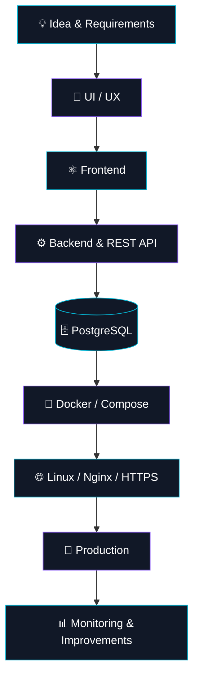

<!-- ===================== HOLOGRAPHIC HEADER ===================== -->

<div align="center">


<a href="https://github.com/acuraels">
  
</a>

<br/>

<a href="https://github.com/acuraels">
  
</a>
<a href="https://github.com/acuraels?tab=followers">
  
</a>


<br/><br/>

<a href="https://acuraels.github.io/dan-portfolio">
  
</a>
<a href="https://t.me/acuraels">
  
</a>
<a href="mailto:daniil.rib@mail.ru">
  
</a>
<a href="https://github.com/acuraels">
  
</a>

</div>

---

<!-- ===================== ABOUT ===================== -->

<h2 align="center">⚡ ABOUT ME</h2>

```typescript
const developer = {
  name: "Daniil Ustinov",
  username: "@acuraels",

  role: "Full-Stack Developer",
  focus: [
    "Web Development",
    "Backend Engineering",
    "DevOps & Infrastructure",
    "AI Integration",
  ],

  education: {
    university: "Ural Federal University",
    degree: "B.Sc. Software Engineering",
    graduation: 2027,
  },

  experience: [
    "Commercial web development",
    "Corporate applications",
    "Production deployment",
    "Team collaboration & code review",
  ],

  philosophy: "Build. Deploy. Improve.",
};
```

Привет! Я **Даниил**, full-stack разработчик и студент 4 курса направления **«Программная инженерия» УрФУ**.

Разрабатываю веб-приложения и цифровые продукты: от проектирования интерфейсов и серверной логики до баз данных, инфраструктуры, развёртывания и поддержки в production.

Начинал с frontend, а сейчас работаю на стыке **frontend, backend, DevOps и продуктовой разработки**.

- 🏗️ **Full-cycle development:** архитектура, API, базы данных, интерфейсы, deployment.
- 🐳 **Infrastructure:** Linux, Docker, Docker Compose, Nginx, VPS, CI/CD.
- 🧠 **AI & LLM:** интеграция AI-сервисов, LLM-сценарии и прикладные AI-продукты.
- 🔬 **Research:** производительность React-приложений, code splitting, Web Performance.
- 🎓 **Education:** УрФУ, Software Engineering, выпуск в 2027 году.

---

<!-- ===================== TECH STACK ===================== -->

<h2 align="center">🛠️ TECH ARSENAL</h2>

<div align="center">

### Frontend Engineering


<br/>

### Backend & Databases


<br/>

`Fastify` · `REST API` · `SQL` · `Authentication` · `Server-side development`

### DevOps & Infrastructure


<br/>

`Docker Compose` · `CI/CD` · `VPS` · `SSH` · `DNS` · `HTTPS` · `Let's Encrypt`

### Tools & Workflow


<br/>

`AI-assisted Development` · `Code Review` · `Git Workflow` · `Product Analytics`

</div>

---

<!-- ===================== ENGINEERING ===================== -->

<h2 align="center">🏗️ FROM IDEA TO PRODUCTION</h2>

<div align="center">



**I don't just write code — I build and deliver working software.**

</div>

---

<!-- ===================== PROJECTS ===================== -->

<h2 align="center">🚀 FEATURED PROJECTS</h2>

<table>
<tr>
<td width="50%" valign="top">

### 🏭 [SPM-METAL](https://spm-metal.ru)

**Commercial B2B Platform · 2026**

Полноценный коммерческий веб-проект для компании «Спецметмаш».

Самостоятельно реализовал полный цикл разработки:

- Каталог металлопроката и SEO-страницы
- Backend, PostgreSQL и административная панель
- Импорт и обновление товаров из Excel
- Авторизация, роли и серверные сессии
- Docker Compose, Linux, Nginx, HTTPS
- Развёртывание на VPS

**Stack**

`Astro` `React` `TypeScript` `Fastify` `PostgreSQL` `Docker` `Nginx`

<a href="https://spm-metal.ru">

</a>

</td>
<td width="50%" valign="top">

### 🧠 [ProectuDa AI](https://proectuda-ai.ru)

**Commercial AI Platform · 2025–2026**

AI-сервис для подбора грантов, конкурсов и возможностей.

- Разработка React/TypeScript интерфейсов
- Интеграция backend через REST API
- AI/LLM-сценарии
- UX/UI и адаптивные интерфейсы
- SEO, аналитика и production-поддержка

**Stack**

`React` `TypeScript` `Vite` `REST API` `LLM` `SEO`

<a href="https://proectuda-ai.ru">

</a>

</td>
</tr>

<tr>
<td width="50%" valign="top">

### 🔎 [Data-point AI](https://data-point-ai.ru)

**AI Navigator · 2025–2026**

Платформа для поиска грантов, конкурсов и возможностей.

- Интерфейсы поиска и фильтрации
- Карточки, дедлайны и статусы
- Интеграция AI-рекомендаций
- REST API и frontend-архитектура

**Stack**

`React` `TypeScript` `Vite` `REST API`

<a href="https://data-point-ai.ru">

</a>

</td>
<td width="50%" valign="top">

### 🏢 Corporate Development

**Brusnika · 2026**

Производственная практика frontend-разработчиком в компании «Брусника».

Работа над внутренней корпоративной системой в существующем monorepo.

- React, TypeScript, Redux/redux-saga
- Корпоративная дизайн-система Figura
- Разработка и улучшение интерфейсов
- Bug fixing, code review, интеграция изменений

**Stack**

`React` `TypeScript` `Redux` `Git`


</td>
</tr>
</table>

---

<!-- ===================== RESEARCH ===================== -->

<h2 align="center">🔬 RESEARCH & ENGINEERING</h2>

### React Performance Optimization

**Экспериментальная оценка влияния разделения кода и оптимизации изображений на производительность одностраничного React-приложения**

Научная публикация, 2026.

Исследовал влияние `React.lazy`, `dynamic import()`, `code splitting`, `WebP` и `lazy loading` на производительность React SPA.

Для эксперимента создал тестовое приложение и сравнил четыре production-конфигурации с помощью Lighthouse.

<div align="center">

| Performance Metric | Before | After |
|:---:|:---:|:---:|
| 🚀 Lighthouse Score | 55 | **93** |
| ⚡ Largest Contentful Paint | 29.62 s | **2.50 s** |
| 📦 Initial Transfer | 7.85 MB | **0.31 MB** |
| 🧩 Initial JavaScript | 3.73 MB | **0.20 MB** |

<a href="https://doi.org/10.34660/INF.2026.93.37.054">

</a>

</div>

---

<!-- ===================== ACHIEVEMENTS ===================== -->

<h2 align="center">🏆 ACHIEVEMENTS</h2>

<div align="center">


</div>

<br/>

- 🎓 **Дважды отличник учёбы УрФУ** — 2024/2025 и 2025/2026.
- 🥇 **1 место** — «Мастер Рокет Сайенс ИРИТ-РТФ УрФУ», 2025.
- 🥉 **3 место** — хакатон «Уральский код», 2025.
- 🏅 **Дважды стипендиат Д. А. Пумпянского** за достижения в учёбе и науке.
- 📈 **117 место из 36 865** участников университетского рейтинга.
- 🧩 **Призёр олимпиады «Изумруд. Студент»**, диплом II степени.
- 📚 **Научная публикация** по оптимизации производительности React SPA.
- 🚀 **Топ-25% лучших решений** CUP IT 2026.
- 📜 **Дважды отмечен ректором УрФУ** за проектную деятельность.

---

<!-- ===================== GITHUB ANALYTICS ===================== -->

<h2 align="center">📊 GITHUB ANALYTICS</h2>

<div align="center">


<br/>


</div>

<br/>

<h3 align="center">⚡ CONTRIBUTION ACTIVITY</h3>

<div align="center">


</div>

---

<!-- ===================== PRINCIPLES ===================== -->

<h2 align="center">💻 DEVELOPMENT MINDSET</h2>

<div align="center">

```text
╔══════════════════════════════════════════════════╗
║                                                  ║
║              ENGINEERING PRINCIPLES              ║
║                                                  ║
║   01  UNDERSTAND THE PROBLEM                     ║
║   02  DESIGN THE SOLUTION                        ║
║   03  WRITE MAINTAINABLE CODE                    ║
║   04  TEST, DEBUG & OPTIMIZE                     ║
║   05  DEPLOY TO PRODUCTION                       ║
║   06  KEEP LEARNING                              ║
║                                                  ║
╚══════════════════════════════════════════════════╝
```

**Software engineering is more than writing code.**

It's about understanding systems, solving real problems and delivering products that work.

</div>

---

<!-- ===================== CONTACTS ===================== -->

<h2 align="center">🌐 LET'S CONNECT</h2>

<div align="center">

Открыт к интересным IT-проектам, профессиональному сотрудничеству и новым возможностям в разработке.

<br/><br/>

<a href="https://t.me/acuraels">

</a>
<a href="mailto:daniil.rib@mail.ru">

</a>
<a href="https://acuraels.github.io/dan-portfolio">

</a>

<br/><br/>


</div>

<!-- ===================== FOOTER ===================== -->


<div align="center">
<sub>Designed with passion · Built by <a href="https://github.com/acuraels">acuraels</a></sub>
</div>
